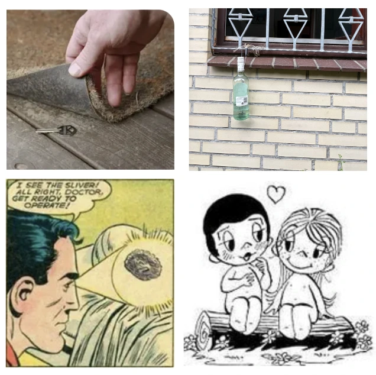

So schwer war das letzte Rätsel nicht, denn es gab fünf Lösungen. Aber eine grundsätzliche Frage stellt sich. Ist der Einsatz von KI erlaubt, oder geboten? Je schwerer das Rätsel, desto eher muss der Rater auf Bilderkennung und schließtlich auf KI zurückgreifen. Wenn das eh alle tun, müssen die Rätsel schwieriger werden, oder? Wie soll ich damit umgehen? Heute jedenfalls gibt es ein Rätsel, bei dem die KI vielleicht nicht helfen kann. (Ausprobiert habe ich es aber nicht.) 
 

 

 

Tip: Das heutige Rätsel versteht sich als Protest gegen die Verherrlichung der Jugend.

 
 

Auflösung pz 183. Zu sehen waren Harald Schmidt und Herbert Feuerstein in <i>Schmidteinander</i>, Doris Day in <i>Mitternachtsspitzen</i>, <i>Scheibenwischer</i> und das Arkham Asylum, wo so Leute wie der Joker sitzen, also eine Irren- <i>Anstalt</i>. Wir haben es mit Satire, Kabaret, Comedy im Deutschen Fernsehen zu tun.

