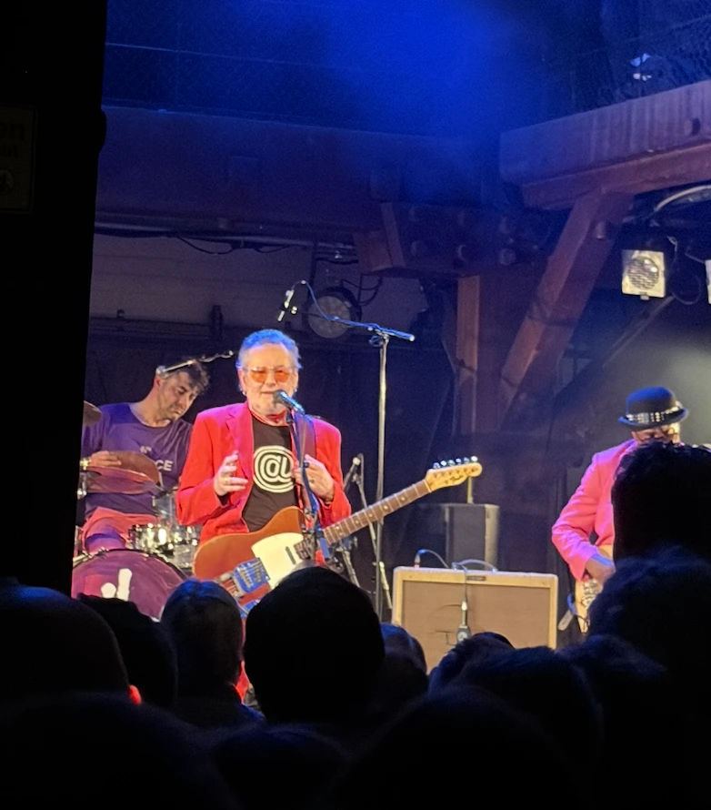

Vier Männer auf der Bühne, Guitarre, Bass, Schlagzeug, Keyboard. Da bin ich Fan von.

Schmissige Rockmusik. Da bin ich Fan von. Launige Kommentare. „Wenn eine Seite reißt beim zweiten Stück, dann ist der Abend gelaufen. Positiv gesehen jetzt.“ - „Eine Tributplatte ist dieses Jahr für mich erschienen. Da habe ich gesehen, wie gut meine Stücke eigentlich sind. Wenn sie nicht andere singen.“ Da bin ich Fan von. Aktuelle Stücke von der neuen Platte, genauso gut wie die Alten. Da bin ich Fan von. Du brauchst keinen Mann, du brauchst Personal. Da bin ich Fan von. Dass man 'nem nackten Mann nicht in die Tasche greifen kann. Da bin ich Fan von. Hier gibt es nix zu sehen. Da bin ich Fan von. 

   

   
   
Die Hamburger zum Mitsingen animieren. Da bin ich Fan von.

Die Rede ist von Stoppok. Dessen Stimme natürlich so klingt, wie die von Marius Müller Westernhagen verstellt. Da bin ich Fan von.

Fabrik