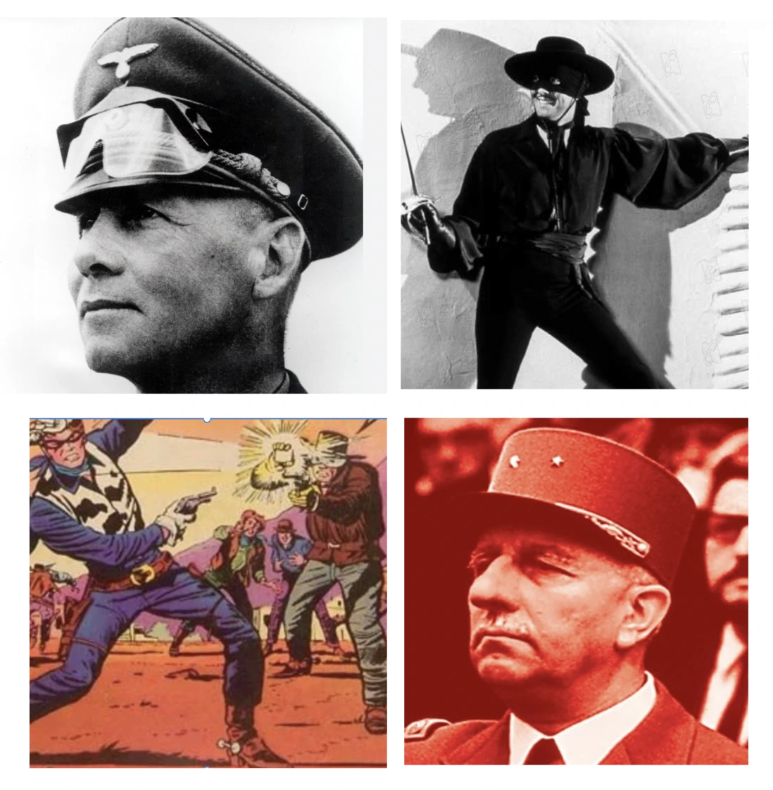

Mit nur zwei Lösungen komme ich zu dem Schluss, dass das letze Rätsel schwierig war, dachte ich mir aber auch. Heute wird es einfacher, mit vielleicht einer harten Nuss. 
 

 

 

Tip: Für passionierte Heimwerker bestimmt besonders leicht. Dicke Bretter müssen nicht gebohrt werden.

 
 

Auflösung pz 184. Zu sehen waren ein <i>Schlüssel unter einer Matte</i>, ein <i>Schnapsflasche an einem Fenster hängend</i>, Superman, der einen <i>Röntgenblick hat</i>, die  <i>Liebe ist … </i> Figuren von Kim Casali, worin definiert wird, was Liebe ist, genau wie es Ali MacGraw in Love Story (Arthur Hiller) tut. Deren Schwiegervater wird von Ray Milland gespielt und der spielt die Hauptrolle in Dial M for Murder (Alfred Hitchcock), The Lost Weekend (Billy Wilder) und in The Man with the X-Ray Eyes (Roger Corman).

