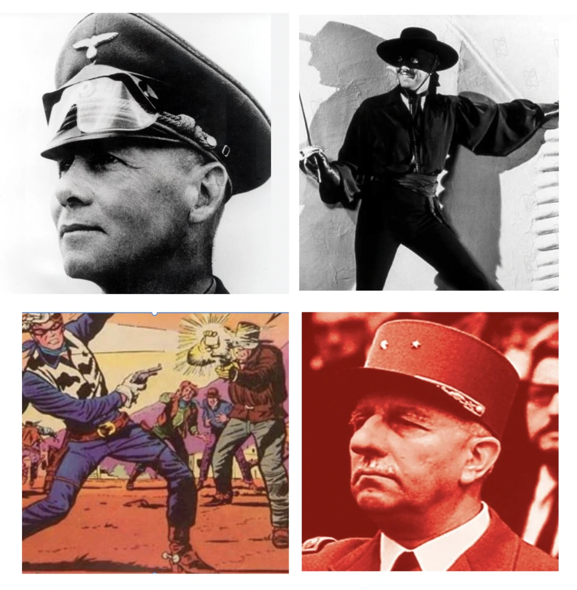

Diesmal gab es vier Lösungen, darunter eine von einem Neurater, KL (Willkommen!). Das heutige Rätsel habe ich von meiner Halde genommen (da ich etwas krank bin) und selbst ein paar Minuten gebraucht, bis mir die Lösung dazu wieder einfiel. Das bedeutet vermutlich, dass es eher schwierig ist. 
 

 

 

Tip: Einer fehlt, und einer muss doppelt gelten.

 
 

Auflösung pz 185. Zu sehen waren Erwin Rommel, der Wüsten<i>fuchs</i>, Tyrone Power als Zorro (spanisch für <i>Fuchs</i>), das Cover meines Lieblingswesterncomics, wo es der Panther (Two Gun Kid) mit dem fiesen <i>Fuchs</i>, zu tun hat, und schließlich de Gaulle (oder doch sein Darsteller) in Der Schakal, der von Edward  <i>Fox</i> gespielt wird. (Übriges ein Beipiel eines Films wo mir das Remake fast geanauso gefällt). Und der Tipp? D. sagte direkt: Hm, Wüstenfuchs und Fuchschwanz, bis zur endgültigen Lösung dauerte es dennoch ein paar Tage.

